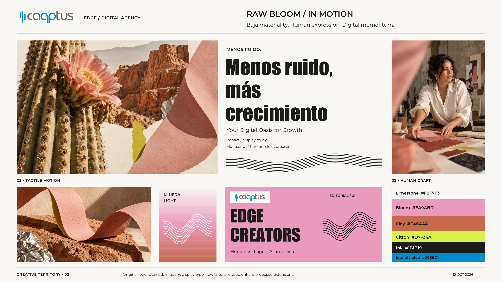

# Capptus Edge Design System

**Raw Bloom / In Motion** — Baja materiality. Human expression. Digital momentum.

The evolving design system for Capptus Edge, the bold digital agency side of Capptus. Current work includes presentation boards, concept imagery, and graphic explorations. Raw Bloom is the preferred creative route; production typography, palette roles, tokens, and components remain subject to approval.



## Boards and image libraries

| Collection | Deliverables |
| --- | --- |
| [Creative territory](explorations/creative-territory-v2/README.md) | Landscape board in PDF, PNG and SVG; 3 images; 3 vector graphics |
| [Brand board](explorations/edge-brand-board-v1/README.md) | Portrait board in PDF, PNG and SVG; signage, mobile, stationery, apparel and poster concepts |
| [Raw Bloom / In Motion](explorations/raw-bloom-image-series-v1/README.md) | 10 standalone images and contact sheet |
| [Baja collages](explorations/baja-collage-series-v1/README.md) | 6 desert/coast collages and contact sheet |

Exact image-generation prompts accompany each collection. SVG boards contain outlined type and embedded imagery; PDFs retain native typography. Workstation-specific authoring scripts and intermediate renders remain local.

## Brand foundation

- [Design specification](design.md)
- [Project brief](docs/project-brief.md)
- [Decisions and approval status](docs/decisions.md)
- [Reference observations](docs/reference-notes.md)
- [Historical route comparison](docs/creative-direction.md)
- [Roadmap](docs/roadmap.md)
- [Verified original logo](assets/README.md)
- [Distribution and provenance](docs/distribution.md)

The original logo and existing tagline remain unchanged. EDGE shown beside the logo is an editorial descriptor, not an approved replacement lockup. Generated people and landscapes are concepts, not evidence of actual team members or projects. Impact is a local display study; no font files are distributed.

## Structure

```text
design.md                 Evolving design-system specification
docs/                     Brief, evidence, decisions, roadmap and distribution
explorations/             Portable boards, concept images, graphics and prompts
assets/logo/              Verified original Capptus artwork
tokens/                   Reserved for approved implementation tokens
sources/manifest.json     Index of original local references
output/                   Local working files and QA records; ignored by Git
scripts/check_project.py  Documentation, reference and release-integrity checks
```

## Validate

Run `python3 scripts/check_project.py`. It checks required files, Markdown links, available local source checksums, and the packaged asset manifest. These checks do not establish visual approval, accessibility, or working application behavior.

No dependency installation or application build is required. Implementation stack and showcase scope remain open. Original decks, screenshots, intermediate files, and font binaries are excluded from the repository. No open-source license is granted; see the distribution notes.

## Repository

Public repository: [luchein-lab/capptus-edge-design-system](https://github.com/luchein-lab/capptus-edge-design-system). Public access does not change the approval status or grant an open-source license to brand assets.
