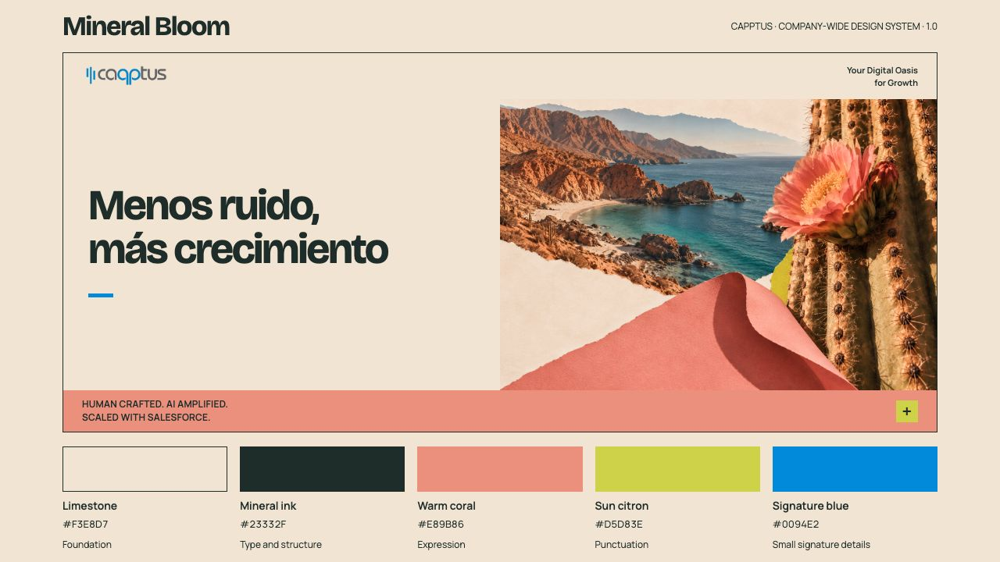

# Capptus Mineral Bloom

The company-wide Capptus design-system baseline, selected on 23 October 2026. Mineral Bloom replaces Raw Bloom as the active direction in this repository.



Warm limestone, mineral ink, coral and sun citron support the Baja collage imagery. Signature blue stays in small recurring details. The original Capptus logo and supplied wording remain unchanged.

## Start here

- [Visual reference](index.html): portable, self-contained documentation using local assets and fonts. Clone the repository and use the local preview command below. GitHub's file view shows the source.
- [Design specification](design.md): palette, typography, imagery, layout and accessible colour pairs.
- [JSON tokens](tokens/mineral-bloom.json) and [generated CSS](tokens/mineral-bloom.css).
- [Selected Baja imagery](assets/imagery/baja/README.md) and [original logo](assets/README.md).
- [Research basis](docs/mineral-bloom-research.md), [decision log](docs/decisions.md) and [validation record](docs/validation.md).

## Selected palette

| Colour | Hex | Role |
| --- | --- | --- |
| Limestone | `#F3E8D7` | Foundation and primary surface |
| Mineral ink | `#23332F` | Type, structure and dark surfaces |
| Warm coral | `#E89B86` | Leading expressive colour |
| Sun citron | `#D5D83E` | Small energetic accents |
| Signature blue | `#0094E2` | Small recurring signature details |

Bricolage Grotesque is the display family; Manrope supports body copy, labels and controls. The reference implementation documents weights and semantic roles without claiming to be a complete product component library.

## Use and validate

Import `tokens/mineral-bloom.css` into an implementation, or consume the JSON source. Edit the JSON and regenerate the CSS with:

```sh
python3 scripts/build_tokens.py
python3 scripts/check_project.py
```

No dependency installation is required for the documentation or checks. The visual reference works offline. For local browser review, run `python3 -m http.server 8000 --bind 127.0.0.1` and open `http://127.0.0.1:8000`.

## Structure

```text
index.html                 Mineral Bloom visual reference
styles/                    Reference layout and locally hosted font styles
tokens/                    Selected palette, aliases and typography
assets/                    Original logo, licensed fonts and selected imagery
docs/                      Specification context, decisions and research
archive/raw-bloom/         Superseded boards and exploration assets
sources/manifest.json      Source provenance
scripts/                   Token generation and package validation
output/                    Local working material, excluded from Git
```

Earlier work is retained in the [historical archive](archive/raw-bloom/README.md). Its colours and older typography are not current system guidance. The repository name remains unchanged for continuity: [luchein-lab/capptus-edge-design-system](https://github.com/luchein-lab/capptus-edge-design-system).

Capptus artwork remains proprietary. Bundled font files retain their SIL Open Font License notices. See [distribution and provenance](docs/distribution.md).
