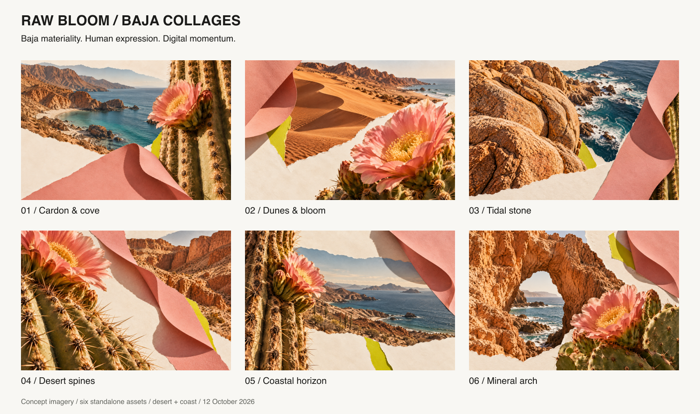

# Mineral Bloom imagery: Baja collages

Six user-selected images retained unchanged from the Raw Bloom exploration. Generated on 12 October 2026 and selected as the visual reference for the company-wide Mineral Bloom palette on 23 October 2026.

1. Cardón and cove: botanical macro, quiet coastal bay and coral paper.
2. Dunes and bloom: sand, mountain horizon and oversized cactus blossom.
3. Tidal stone: mineral texture, coastal water and paper rhythm.
4. Desert spines: cactus detail, eroded canyon and negative space.
5. Coastal horizon: desert, sea and tactile botanical foreground.
6. Mineral arch: conceptual coastal geology, cactus and sea.

The shared language is physical photographic collage: torn cream paper, warm rock, natural cactus texture, folded coral paper and small citron accents. The sea supplies muted blue. Photographic pigments are not exact colour tokens.

All six images are text-free and logo-free. Original PNGs remain unchanged in `images/`. These are generated concepts, not verified photographs of named locations. See [prompts](prompts.json) for generation provenance and [manifest](manifest.json) for dimensions and SHA-256 hashes. Use individual images for applications; the contact sheet is a review layout.
